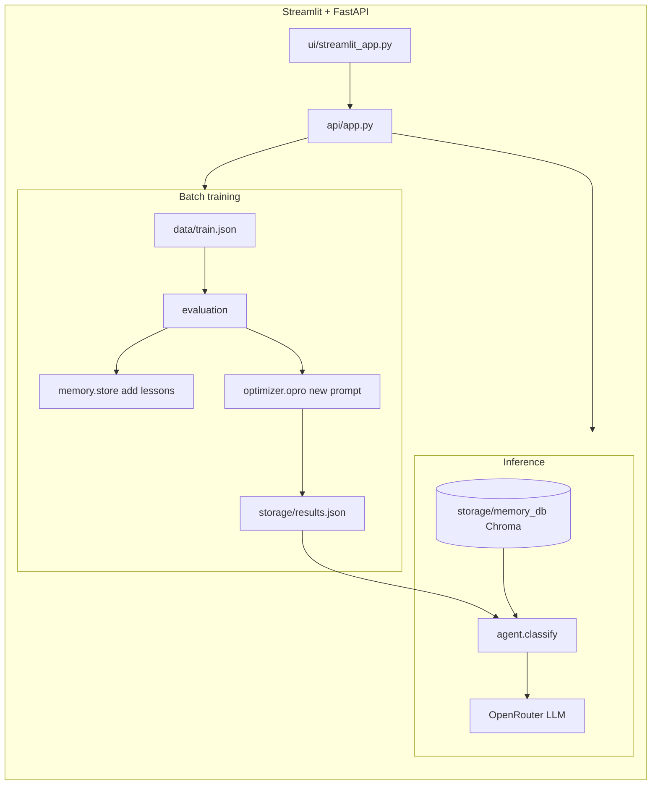

# Self-Improving Intent Agent

Customer-support **intent classification** that gets better in two ways:

1. **Batch training (OPRO-style)** — Rewrite the system prompt across several rounds using train-set accuracy and mistake summaries.
2. **Live feedback** — Confirm or correct predictions in chat; new rules go into **ChromaDB** and are retrieved at classify time.

The underlying LLM model stays fixed (set `OPENROUTER_MODEL` in `.env`, default **`openai/gpt-4o-mini`** via [OpenRouter](https://openrouter.ai/)). What changes is the **prompt** (from training) and **lesson memory** (from training mistakes and user feedback).

## Architecture



| Piece | Role |
|-------|------|
| `storage/results.json` | Best prompt and training log (written after `/train` or the training module) |
| `storage/memory_db/` | Persistent Chroma collection `lessons` — short rules + reinforcement scores |
| `get_prompt()` | Uses `best_prompt` from `storage/results.json`, or a default if you have not trained yet |

## Intent labels

`match_invoice`, `unmatched_items`, `upload_document`, `amount_mismatch`, `recon_status`, `user_access`, `audit_query`, `login_help`, `other`

## Requirements

- Python **≥ 3.14** (`pyproject.toml`)
- [uv](https://docs.astral.sh/uv/) (recommended)
- `OPENROUTER_API_KEY` in `.env`

## Setup

```bash
cd intent-agent
uv sync
```

Copy the template and set your key:

```bash
cp .env.example .env
```

Edit `.env`:

```env
OPENROUTER_API_KEY=your_key_here
OPENROUTER_MODEL=openai/gpt-4o-mini
```

`.gitignore` already excludes `.env` and `storage/` (Chroma `memory_db/` and `results.json`).

## Lint, tests & Git

```bash
uv sync --group dev
uv run ruff check .
uv run pytest
```

Before pushing to GitHub, see **[CONTRIBUTING.md](CONTRIBUTING.md)** (what to commit, branch workflow, first upload).

## Quick start (UI)

Use two terminals from the project root.

**Terminal 1 — API**

```bash
uv run uvicorn intent_agent.api.app:app --reload
```

Docs: [http://127.0.0.1:8000/docs](http://127.0.0.1:8000/docs)

**Terminal 2 — Streamlit**

```bash
uv run streamlit run src/intent_agent/ui/streamlit_app.py
```

### Streamlit tabs

| Tab | What it does |
|-----|----------------|
| **Talk to the agent** | Classify a message → confirm **Yes** / **No** → optional intent picker on wrong guesses. Calls `/classify` and `/feedback`. |
| **Training and memory** | **Run training** (`POST /train`), score chart, prompt history, lessons table. |

**Sidebar — Memory** lists all lessons from `GET /lessons` (same store as the train tab). It is refreshed **after** tab logic runs so it stays in sync right after training (no need to send a chat message first).

## How batch training works

1. **Evaluate** — Score the current prompt on `data/train.json`; collect mistakes.
2. **Remember** — LLM writes a short rule per top mistake; near-duplicates are skipped (`memory.add`, distance under 0.2).
3. **Reinforce** — Lessons used during a call get score +1 / −1 when `learn=True` (training) or via `/feedback` (chat).
4. **Prune** — `memory.cleanup()` removes lessons with score ≤ −2.
5. **Optimize prompt** — Meta-prompt with history + mistakes → new text inside `<PROMPT></PROMPT>`.
6. **Pick best** — Highest train score → evaluate on `data/test.json` → write `storage/results.json`.

### CLI only

```bash
uv run python -m intent_agent.training.train
```

Change rounds in `run_training(rounds=5)` or use `POST /train?rounds=5`.

## How live feedback works

1. `POST /classify` — Retrieves top‑k similar lessons, runs the classifier.
2. `POST /feedback` with `text`, `predicted`, `correct`:
   - **Confirmed** (`correct == predicted`) — Bump scores on lessons that were used; store a simple confirmation rule.
   - **Corrected** — Penalize used lessons; `make_lesson()` writes a new rule and saves it.

You can use chat **without** running training first; classification falls back to the default prompt until `storage/results.json` exists.

## API reference

| Method | Path | Description |
|--------|------|-------------|
| `POST` | `/train?rounds=5` | Run full training loop; returns log, `best_prompt`, `test_score` |
| `GET` | `/results` | Read `storage/results.json` (**404** until training has run) |
| `POST` | `/classify` | `{"text": "..."}` → intent (best or default prompt + memory) |
| `POST` | `/feedback` | `{"text", "predicted", "correct"}` → learning + optional `lesson` text |
| `GET` | `/lessons` | `[{"lesson", "score"}, ...]` |

### Example: classify + feedback

```bash
curl -s -X POST http://127.0.0.1:8000/classify \
  -H 'Content-Type: application/json' \
  -d '{"text": "Who tied payment 9912 to invoice INV-88?"}'

curl -s -X POST http://127.0.0.1:8000/feedback \
  -H 'Content-Type: application/json' \
  -d '{"text": "Who tied payment 9912 to invoice INV-88?", "predicted": "match_invoice", "correct": "audit_query"}'
```

## Data format

JSON arrays of `{ "text", "intent" }`:

- `data/train.json` — optimization + lesson creation during training  
- `data/test.json` — held-out metric after training  
- `data/demo.json` — hard messages for the Demo set tab  

## Project layout

```
intent-agent/
├── src/intent_agent/      # the package
│   ├── config.py          # settings from .env + all project paths
│   ├── llm.py             # OpenRouter call
│   ├── agent/             # classify, LABELS, DEFAULT_PROMPT
│   ├── memory/            # Chroma lesson store (add, search, update, cleanup)
│   ├── optimizer/         # OPRO prompt rewrite + make_lesson
│   ├── evaluation/        # accuracy + mistakes, memory score updates
│   ├── training/          # run_training loop
│   ├── tools/             # agent tools (to be added)
│   ├── api/               # FastAPI app
│   └── ui/                # Streamlit app
├── data/                  # train.json, test.json, demo.json
├── storage/               # memory_db/ and results.json (gitignored, generated)
├── scripts/               # inspect_chroma.py (read-only memory inspector)
└── tests/                 # import smoke tests
```

## Configuration

| Knob | Where |
|------|--------|
| Model / OpenRouter | `.env` — see `src/intent_agent/config.py` (`OPENROUTER_MODEL`, `OPENROUTER_BASE_URL`, `OPENROUTER_API_KEY`) |
| File paths | `src/intent_agent/config.py` — `DATA_DIR`, `TRAIN_FILE`, `TEST_FILE`, `DEMO_FILE`, `STORAGE_DIR`, `MEMORY_DB_DIR`, `RESULTS_FILE` |
| Training rounds | `training/train.py` or `POST /train?rounds=` |
| Mistakes → lessons per round | `training/train.py` — top **3** |
| Mistakes in meta-prompt | `optimizer/opro.py` — up to **5** |
| Lessons retrieved per message | `agent/classify.py` — `memory.search(..., k=3)` |
| Dedupe threshold | `memory/store.py` — distance under **0.2** skips add |
| Prune threshold | `memory/store.py` — `cleanup(min_score=-2)` |

## Inspecting ChromaDB

```bash
uv run python scripts/inspect_chroma.py
```

## Resetting ChromaDB (lesson memory)

Lessons are stored under **`storage/memory_db/`** (collection **`lessons`**).

1. **Stop** uvicorn, Streamlit, and any training run (avoid file locks).
2. Delete Chroma data:

   ```bash
   rm -rf storage/memory_db
   ```

3. **(Optional)** Drop saved prompt and training log:

   ```bash
   rm -f storage/results.json
   ```

4. Train or chat again — `storage/memory_db/` is recreated on the next start.

`memory.cleanup()` only removes weak lessons (score ≤ −2), not the whole DB. There is no reset HTTP endpoint.

## Troubleshooting

| Symptom | Likely cause |
|---------|----------------|
| Streamlit: “Could not reach the API” | Start `uv run uvicorn intent_agent.api.app:app` on port **8000** (matches `API` in `ui/streamlit_app.py`). |
| `ModuleNotFoundError: intent_agent` | Run `uv sync` so the package is installed from `src/`. |
| `/results` or classify errors about missing file | Run training once, or rely on default prompt until `storage/results.json` exists. |
| Training is slow | Each round calls the LLM for every example plus meta-prompt / lesson writes; reduce `rounds` or shrink `train.json` for demos. |
| Duplicate or noisy lessons | Tighten dedupe in `memory/store.py` or run `rm -rf storage/memory_db` for a clean memory slate. |

## Author

Chathuri Perera — chathuri@gluonforce.com
