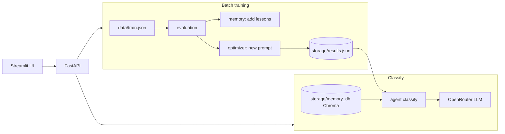

# Self-Improving Intent Agent

A reconciliation **intent classifier** that improves without changing the underlying model. The LLM stays frozen. What improves is:

1. **The prompt**, through batch training (OPRO-style rewrites scored on training data).
2. **The memory**, through lessons stored in ChromaDB. Lessons come from training mistakes and from user feedback in chat.

The LLM is called through [OpenRouter](https://openrouter.ai/). The default model is `openai/gpt-4o-mini`, set by `OPENROUTER_MODEL` in `.env`.

## Intent labels

| Label | Shown in UI as |
|-------|----------------|
| `match_invoice` | Match invoice |
| `unmatched_items` | Unmatched items |
| `upload_document` | Upload document |
| `amount_mismatch` | Amount mismatch |
| `recon_status` | Recon status |
| `user_access` | User access |
| `audit_query` | Audit log |
| `login_help` | Login help |
| `other` | Other |

The labels are defined as `LABELS` in `src/intent_agent/agent/classify.py`.

## Architecture



| Piece | Role |
|-------|------|
| `storage/results.json` | Best prompt, training log, and test scores. Written by training. |
| `storage/memory_db/` | Chroma collection `lessons`. Holds short rules and their scores. |
| Default prompt | Used when `results.json` does not exist yet, or when a request turns memory and the trained prompt off. |

## Requirements

- Python **3.14** or newer (`pyproject.toml`)
- [uv](https://docs.astral.sh/uv/)
- An OpenRouter API key

## Setup

```bash
cd intent-agent
uv sync
cp .env.example .env
```

Edit `.env`:

```env
OPENROUTER_API_KEY=your_key_here
OPENROUTER_MODEL=openai/gpt-4o-mini
# OPENROUTER_BASE_URL=https://openrouter.ai/api/v1
```

Settings load through Pydantic Settings in `src/intent_agent/config.py`. The API key is never printed. Restart the API after changing `.env`, because settings are cached.

## Running the app

Use two terminals from the project root.

**Terminal 1: API**

```bash
uv run uvicorn intent_agent.api.app:app --reload
```

API docs: [http://127.0.0.1:8000/docs](http://127.0.0.1:8000/docs)

**Terminal 2: UI**

```bash
uv run streamlit run src/intent_agent/ui/streamlit_app.py
```

Open [http://localhost:8501](http://localhost:8501). Start the API first, because the UI calls it.

### Training from the command line

```bash
uv run python -m intent_agent.training.train
```

This runs the same loop as the **Run training** button, with 5 rounds.

## The UI

### Sidebar

| Control | What it does |
|---------|----------------|
| **Which agent replies in chat** | **Normal**: original prompt, no memory, no feedback. **Self-improving**: trained prompt plus retrieved lessons, with Yes/No feedback. |
| **Lessons** | Every lesson in memory with its score. Refreshes after chat feedback and after training. |

### Tabs

| Tab | What it does |
|-----|----------------|
| **Chat** | Chat window with a **Typing...** indicator while the API works. Self-improving mode shows lessons used for each reply and asks **Is that right?** with Yes and No. Choosing No opens an intent picker. |
| **Before vs After** | Classifies one message twice: original prompt with no memory, then trained prompt with retrieved lessons. Enter the correct intent to mark each guess right or wrong. |
| **Demo set** | Runs every message in `data/demo.json` before and after, then shows the number correct and a table. |
| **Training results** | Train-score chart, before and after test scores, prompt history, first and best prompt, and the lessons table. **Compute before score** runs once and is saved. **Run training** is at the bottom. |

## How batch training works

Each round:

1. **Evaluate.** Classify every example in `data/train.json` with the current prompt. Record the mistakes.
2. **Remember.** Ask the LLM for a short rule for each of the first 3 mistakes. Save each rule with score 0. A rule is skipped if a very similar lesson already exists (distance under 0.2).
3. **Reinforce.** Each lesson retrieved during evaluation gets +1 if that guess was right and −1 if it was wrong.
4. **Prune.** `memory.cleanup()` deletes lessons with score −2 or lower.
5. **Rewrite the prompt.** The LLM sees the prompt history and up to 5 mistakes, then writes a new prompt inside `<PROMPT></PROMPT>`.

After the rounds, the prompt with the best training score is evaluated on `data/test.json`. The result is written to `storage/results.json`.

The test set is not used for learning. Test evaluation does not add or change lessons.

## How chat feedback works

Feedback exists only in **Self-improving** mode.

1. `POST /classify` with `use_memory: true` and `use_best_prompt: true` returns the intent and the lessons that were retrieved.
2. The user presses **Yes** or **No**. The UI calls `POST /feedback`.

| Button | Effect |
|--------|--------|
| **Yes** | +1 on each lesson that was retrieved for that message. No new lesson is saved. The reply is "Thanks. That guess was right, so no new lesson was added." |
| **No** | −1 on each retrieved lesson. The LLM writes one rule for the mistake. The rule is saved at score 0 unless a very similar lesson already exists. The user then picks the correct intent. |

Feedback never deletes lessons. Cleanup runs only during training.

A new lesson starts at score 0. A score of 0 does not mean the lesson is removed.

## API reference

| Method | Path | Description |
|--------|------|-------------|
| `POST` | `/train?rounds=5` | Run the training loop. Returns `log`, `best_prompt`, and `test_score`. |
| `GET` | `/results` | Read `storage/results.json`. Returns **404** until training has run. |
| `GET` | `/results?ensure_before=true` | Score the original prompt on the test set once, with no memory, and save `test_score_before`. |
| `POST` | `/classify` | Body: `{"text", "use_memory", "use_best_prompt"}`. Both flags default to `true`. Returns `intent`, `prompt`, and `lessons`. |
| `POST` | `/feedback` | Body: `{"text", "predicted", "correct"}`. Same intent returns `{"learned": "confirmed"}`. A different intent returns `{"learned": "corrected", "lesson": "..."}`. |
| `GET` | `/lessons` | Returns `[{"lesson", "score"}, ...]`. |

### Example

```bash
curl -s -X POST http://127.0.0.1:8000/classify \
  -H 'Content-Type: application/json' \
  -d '{"text": "Who tied payment 9912 to invoice INV-88?", "use_memory": false, "use_best_prompt": false}'

curl -s -X POST http://127.0.0.1:8000/feedback \
  -H 'Content-Type: application/json' \
  -d '{"text": "Who tied payment 9912 to invoice INV-88?", "predicted": "match_invoice", "correct": "audit_query"}'
```

## Data

Each data file is a JSON array of objects with `text` and `intent`:

| File | Used for |
|------|----------|
| `data/train.json` | Training: evaluation, lessons, and prompt rewrites |
| `data/test.json` | Held-out score after training, and the before score |
| `data/demo.json` | The Demo set tab |

The training set is deliberately hard. It includes confusable pairs such as audit log vs match invoice, upload vs match, amount gap vs unmatched, and recon vs unmatched.

## Configuration

| Setting | Where |
|---------|-------|
| Model, base URL, API key | `.env`, read by `src/intent_agent/config.py` |
| Paths | `src/intent_agent/config.py`: `DATA_DIR`, `TRAIN_FILE`, `TEST_FILE`, `DEMO_FILE`, `STORAGE_DIR`, `MEMORY_DB_DIR`, `RESULTS_FILE` |
| Training rounds | `POST /train?rounds=` or `run_training(rounds=5)` in `training/train.py` |
| Lessons saved per round | First 3 mistakes, in `training/train.py` |
| Mistakes shown to the prompt rewriter | Up to 5, in `optimizer/opro.py` |
| Lessons retrieved per message | `k=3`, in `agent/classify.py` |
| Duplicate threshold | Distance under 0.2, in `memory/store.py` |
| Prune threshold | Score −2 or lower, in `memory/store.py` |

## Project structure

```
intent-agent/
├── src/intent_agent/
│   ├── config.py          Settings from .env and all project paths
│   ├── llm.py             OpenRouter client
│   ├── agent/             classify(), LABELS, DEFAULT_PROMPT
│   ├── memory/            Chroma lesson store: add, search, update, cleanup
│   ├── optimizer/         OPRO prompt rewrite and make_lesson()
│   ├── evaluation/        evaluate(): accuracy, mistakes, score updates
│   ├── training/          run_training() loop
│   ├── tools/             reserved for agent tools
│   ├── api/               FastAPI app
│   └── ui/                Streamlit app
├── data/                  train.json, test.json, demo.json
├── storage/               memory_db/ and results.json (generated, gitignored)
├── scripts/               inspect_chroma.py (read-only memory inspector)
├── tests/                 import smoke tests
├── .github/workflows/     Ruff CI
├── .env.example
├── pyproject.toml
└── README.md
```

## Inspecting memory

```bash
uv run python scripts/inspect_chroma.py
```

This prints the files on disk, the collection, every lesson with its score, and a sample query. It does not change anything.

## Resetting memory

Lessons live in `storage/memory_db/` (collection `lessons`).

1. Stop the API, the UI, and any training run.
2. Delete the memory:

   ```bash
   rm -rf storage/memory_db
   ```

3. Optional: also delete the saved prompt and training log:

   ```bash
   rm -f storage/results.json
   ```

The memory folder is recreated the next time the app starts. There is no HTTP endpoint to reset memory.

## Development

```bash
uv sync --group dev
uv run ruff check .
uv run pytest
```

- Ruff checks `E`, `F`, and `UP`. `E501` and `E741` are ignored.
- `tests/test_imports.py` imports every module and checks the data paths. The Streamlit file is compiled, not imported.
- CI runs `uv run ruff check .` on pushes to `main` and on pull requests.

For commit and branch rules, see [CONTRIBUTING.md](CONTRIBUTING.md).

## Git

These paths are gitignored and never committed:

- `.env`, which holds your API key
- `storage/`, which holds the Chroma memory and `results.json`
- Virtual environments, caches, and editor files

Commit `data/` changes when you change the training, test, or demo sets.

## Troubleshooting

| Symptom | Likely cause |
|---------|--------------|
| UI says it could not reach the API | The API is not running. Start `uv run uvicorn intent_agent.api.app:app` on port **8000**. |
| `ModuleNotFoundError: intent_agent` | Run `uv sync` so the package is installed from `src/`. |
| Results or classify errors about a missing file | Train once, or use the default prompt until `storage/results.json` exists. |
| Sidebar lessons do not match the Training tab | Restart Streamlit so it loads the current code. |
| Training is slow | Each round calls the LLM for every example, plus the prompt rewrite and lesson writes. Reduce `rounds` or shrink `train.json` for a quick run. |
| Too many similar lessons | Check the duplicate threshold in `memory/store.py`, or reset memory. |

## Author

Chathuri Perera: chathuri@gluonforce.com
